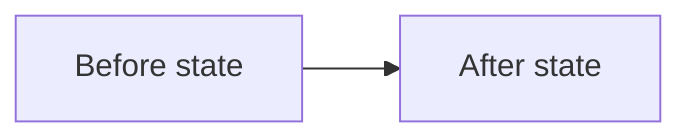

# 🧩 Information Representation Design

Use these **four stages as an initial writing pass**. They describe activities in the writing workflow, **not a fixed hierarchy of information**. Revisit any stage at any nesting level: a section can contain a table, a table cell can contain a list or smaller semantic pattern, and any resulting item may need its own label or explanation.

1. **[🧭 Stage 1 — Structure the reader's route](#stage-1).** Define what questions the sections answer and how their children are organized.
2. **[🗂️ Stage 2 — Choose a representation inside each section](#stage-2).** Select prose, lists, tables, code, or visuals for the content inside each section.
3. **[🎛️ Stage 3 — Apply rules to the chosen format](#stage-3).** Use the applicable rules for each representation actually selected.
4. **[🔗 Stage 4 — Anchor sources and recurring references](#stage-4).** Resolve source links and repeated references before handoff.

Repeat structural decisions when a later representation creates another container. Do not assume that a particular semantic pattern must always be inside another pattern.

This skill organizes information already selected for the reader. Use [relevance-first-information-design](../relevance-first-information-design/SKILL.md) to decide which information belongs on the current surface and which should remain behind deeper navigation.

<a id="stage-1"></a>
## 🧭 Stage 1 — Structure the reader's route

Use these **four structural decisions recursively**. They are complementary ways to organize information, **not a sequence** and not a hierarchy in which one pattern must contain another.

**Structural decisions in this stage:**

- [S1 — Define the parent contract](#structure-1)
- [S2 — Compose semantic patterns](#structure-2)
- [S3 — Label answers and attach detail](#structure-3)
- [S4 — Adapt to the medium](#structure-4)

<a id="structure-1"></a>
### S1 — Define the parent contract

Identify the questions a reader needs answered and group the corresponding material. For every parent heading or list lead-in, identify the type of its immediate children:

- **Steps:** actions or stages in a specified order.
- **Principles:** independent guidelines, each with supporting detail.
- **Reasons:** separate explanations of why something matters.
- **Alternatives:** comparable choices.
- **Examples:** concrete illustrations of an introduced rule.
- **Information categories:** different content types grouped by a clear purpose.

Before introducing sibling headings, state their shared type and whether their order matters. Number actual sequences. Use identifiers such as P1/P2 for principles only when later references benefit; numbers do not automatically imply order.

A parent example and its contrasting cases must have **visibly different heading levels**. Likewise, a principle's example belongs beneath that principle, not beside it.

#### Comparison example — parent contracts

The following are **two versions of the same Markdown structure**. Both are shown as Markdown fences, and their labels appear at the same heading level beneath this example.

##### Negative example — Ambiguous

```markdown
## Release guidance

### Validate a release
Validate the candidate and verify the result.

### Preserve rollback paths
Keep an option to undo deployment.

### Why staged rollout matters
A gradual rollout limits the impact of regressions.
```

All three subsections are presented as peers, although they respectively describe a procedure, a principle, and a reason.

##### Positive example — Clear

```markdown
## Release procedure

Perform these steps in order:

1. Validate the candidate release.
2. Roll out gradually.
3. Verify the result.

## Release principles

Apply these principles throughout the procedure:

### P1 — Make failures visible
Explain the principle and its implications.

### P2 — Preserve rollback paths
Explain the principle and its implications.

## Reasons for staged rollout

- Limit the impact of regressions.
- Detect failures before wider deployment.
```

The parent labels now identify steps, principles, and reasons; their children satisfy those contracts.

<a id="structure-2"></a>
### S2 — Compose semantic patterns

Use the following **alternative semantic patterns** at any level of the information hierarchy. They are neither mandatory templates nor subordinate to S1's categories:

- **Peer items** — independent principles, reasons, changes, or decisions.
- **State → elaborate → exemplify** — claim, explanation, then example or evidence.
- **Before → after → how** — initial state, resulting state, and mechanism of change.
- **What → why → how** — outcome, rationale, and implementation.
- **Completed → remaining** — finished and outstanding work.
- **Claim → meaning → evidence → impact** — assertion, interpretation, proof, and consequence.
- **When → then** — condition and the action or outcome when it holds.
- **Situation → complication → question → answer** — context, disruption, resulting question, and resolution.

**Patterns can contain each other in either direction.** For example, a PR description may have top-level `What`, `Why`, and `How` sections, with individual changes under `What`, reasons under `Why`, and decisions under `How`. Conversely, a section for one change may itself contain `Before`, `After`, and `How` subsections. Use whichever ordering answers the reader's questions.

Reapply a pattern inside a list item, a table cell, or another component when its content warrants further structure and the medium supports it. A table is not the end of semantic organization.

<a id="structure-3"></a>
### S3 — Label answers and attach detail

For each meaningful block, identify the reader question it answers. Give it a **short, skimmable semantic label**, then keep its explanation, evidence, examples, and qualifications directly below.

- Aim for one to three words when that remains accurate; use a longer name where needed.
- Choose a heading, bold lead-in, list label, or another appropriate level.
- Keep details underneath the item they explain rather than promoting them to sibling items.
- Give comparable siblings consistent labels and layouts.

**Example — one principle in a testing guide**

- **Assert outcomes.** Check database state after an operation rather than an internal helper call. For example, `assert row["status"] == "ready"` checks an observable outcome; `mock_writer.assert_called_once()` ties the test to an implementation detail.

A longer guide could give the principle a heading; a concise list can use the bold lead-in above.

<a id="structure-4"></a>
### S4 — Adapt to the medium

Use headings for document and article navigation. In a brief message, an opening clause or bold label may be enough. Choose the smallest hierarchy that exposes meaningful relationships.

At each nesting level, compare the actual draft with its parent's contract:

- **Role:** do all immediate children have the promised type?
- **Presentation:** are comparable peers shown at the same visual level and with the same representation?
- **Composability:** can an item contain an additional pattern or layout without being mistaken for a peer?
- **Order:** are actual sequences distinguished from unordered alternatives?
- **Navigation:** can a reader find the right answer without reading unrelated prose?

Correct mismatches wherever they occur, including inside tables, list items, and examples.

<a id="stage-2"></a>
## 🗂️ Stage 2 — Choose a representation inside each section

After identifying semantic relationships, choose how they appear in the target medium. **Organizing structures** and **content representations** are different choices: headings, lists, and tables organize other information; prose, code excerpts, and visualizations communicate content inside those structures.

### Organizing structures

These forms can contain further semantic patterns and other representations:

| Relationship to express | Organizing structure |
| --- | --- |
| Topic and subtopic navigation | Headings and nested sections |
| Independent peer items | Bulleted list |
| Steps in required order | Numbered list |
| Multiple records with comparable fields | Table |

Choose these based on the relationship, not on the presence of a specific content type. Repeated Bad/Good examples, for instance, share two fields and therefore are strong candidates for a two-column comparison table.

**Continue structuring inside a container:** A table cell can contain multiple labeled points or a nested list when the renderer supports them. Apply the same reader-question and sibling-consistency rules to those entries. If the table renderer cannot handle multi-item cells or the content becomes difficult to scan, keep cells concise and provide labeled details immediately below the table.

### Content representations

These convey the substance within the chosen layout. They are **not competing alternatives** to headings, lists, or tables:

| Information to communicate | Content representation |
| --- | --- |
| Reasoning, explanation, consequences | Prose |
| Exact expression, identifier, command, or implementation | Inline code or code fence |
| Relationships, dependencies, topology, or process flow | Diagram |
| Quantitative comparison or trend | Chart |

A table can contain inline code in its cells; a section can include a diagram with explanatory paragraphs; a list item can contain both a short statement and a code example. Code fences usually function as content elements rather than Markdown containers that hold other rendered tables.

**Example — environment variables**

In a section titled **Configure environment variables**, explain where to configure the settings, then use a table to compare the variables. Here, the table organizes records while the identifiers and values are represented as inline code.

| Variable | Effect | Example value |
| --- | --- | --- |
| `REPOS_DIR` | Root directory for cloned repositories | `~/Repos` |
| `LOG_LEVEL` | Application log verbosity | `debug` |

These are illustrative settings, not values inspected from a project.

<a id="stage-3"></a>
## 🎛️ Stage 3 — Apply rules to the chosen format

The four subsections below are **representation categories**, not ordered steps. Apply only the rules for formats used in the current document.

### 📝 Prose and lists

Apply the following four **text and example rules** to prose, lists, and comparable example groups:

#### T1 — Frame each list

Use a short label or lead-in to say what its children represent and why the reader needs them.

- **Bullets:** unordered items of the same kind.
- **Numbers:** steps whose order matters.
- **Short prose:** connected explanation where causal flow matters more than scanning separate entries.

Give list items meaningful names when useful. For a short message, one sentence can serve as both the label and lead-in.

##### Comparison example — PR-review list

The following examples show two versions of the same PR-review list.

###### Negative example — Unframed

```markdown
## Review

- PR A
- PR B
- PR C
```

###### Positive example — Framed

```markdown
## Pull requests to review

Review these in priority order; read the description before each diff:

1. **PR A** — Fix the data-loss scenario.
2. **PR B** — Remove duplicate processing.
3. **PR C** — Simplify the deployment path.
```

#### T2 — Separate scannable items and distinct rules

When one sentence contains three or more independently scannable items, replace the enumeration with a lead-in and one bullet per item. Keep inseparable pairs, such as "staged versus unstaged changes", together.

When the text changes from describing contents to stating rules, exceptions, or consequences, start a second explicitly named group.

##### Comparison example — updater behavior

The following examples show the same updater behavior with different information structures.

###### Negative example — Hard to scan

```markdown
The updater preserves staged versus unstaged changes, untracked and
ignored files, symlinks, executable modes, conflicted indexes, and
previous commits. Submodule copies receive independent Git metadata.
Interrupted-operation metadata is saved as evidence; archived
operations are not automatically resumed in recovery copies.
```

###### Positive example — Easier to scan

```markdown
The updater preserves:

- staged versus unstaged changes
- untracked and ignored files
- symlinks
- executable modes
- conflicted indexes
- previous commits

The following rules apply:

- Submodule copies receive independent Git metadata.
- Interrupted-operation metadata is saved as evidence.
- Archived operations are not automatically resumed in recovery copies.
```

#### T3 — Make paragraphs purposeful

Keep explanatory prose inside the statement, rule, or question it develops.

- Begin with the claim or an identifying lead-in.
- Elaborate when a short label is too abstract.
- Show an example or evidence when the reader needs to see what the claim means.
- Start a new paragraph or list item when the subject, action, or reason changes.

Keep genuinely connected causal reasoning in prose. A new sentence does not automatically require a separate paragraph.

#### T4 — Keep peer examples comparable

When two or more examples are siblings of one parent, use **the same kind of representation, labeling, and visual level** for each. Name the shared parent **Comparison example — [topic]** (or an equivalent clearly typed label). Name contrasting children **Negative example — [specific defect]** and **Positive example — [specific improvement]** so that the reader can identify the role of each case from the outline, not only the adjective. For example, do not compare an "Ambiguous" Markdown snippet written in prose with a "Clear" snippet rendered in a code fence.

- **Compare like with like.** If one case is a Markdown example, render the other as Markdown too. If each case has the same fields, align them as rows or columns of a comparison table.
- **Expose hierarchy and role.** Give the shared comparison its own parent label; make the positive and negative cases visibly subordinate and identically leveled. Use headings or table headers that explicitly identify **Negative example** and **Positive example**, not only adjectives such as "Unframed" or "Clear". The specific adjectives may follow the semantic role.
- **Use a suitable layout.** A side-by-side Bad/Good table works for short comparisons. For longer code or Markdown blocks, use parallel labeled subsections with matching language-tagged fences.
- **Preserve content.** Keep comparable context and sufficient detail for both cases; do not shorten one side so far that the comparison changes meaning.

Apply this to alternatives, before/after states, examples, reasons, rules, and other peer items—not only to code snippets.

**Before presenting a comparison**, inspect each case in the actual draft. Verify that every label declares the **type** of case (positive/negative example) before the specific condition, and that parallel cases use matching containers (fence versus fence, quote versus quote, or table row versus table row), matching syntax highlighting when they demonstrate the same language, and equally subordinate labels. If one side is prose and the other is a fenced excerpt, make both comparable excerpts or change the whole comparison format. Recheck the rendered hierarchy, not just the Markdown source.

### 📋 Tables

Use a table when the reader compares records with the same columns or conditions with the same fields.

- State the table's purpose in a heading or preceding sentence.
- Use each row for one comparable record.
- Put repeated labels in column headers rather than repeating them inside every cell.
- Split unrelated rules or multi-paragraph explanations out of cells and place them under their owning section.
- Prefer a numbered list for a simple sequence instead of a table with one row per step.
- For recurring examples with the same two fields, prefer a compact comparison table when the cells remain readable.
- For a cell that itself contains multiple items, use renderer-supported lists, line breaks, or short labels. Reapply semantic grouping inside that cell; if the resulting cell becomes unwieldy or its renderer does not support nested formatting, put the elaboration in a clearly labeled section beneath the table.

### 📊 Diagrams and charts

Use a diagram when a relationship, process, topology, or spatial structure is easier to understand visually. Use a chart for quantitative comparisons or trends. **Make the figure and its surrounding explanation two views of the same information**, not disconnected pieces.

#### Match referential labels exactly

For every visual label that names an existing code element, document section, category, series, or other identifiable source concept:

- **Locate the target.** Find the actual symbol, heading, data field, or named concept in the current code or document.
- **Copy its exact name.** Match spelling, case, underscores, punctuation, and word order. Do not paraphrase a referential label merely to make the diagram shorter.
- **Use the same name nearby.** Place the exact label in the associated heading, bold lead-in, list item, or table row where its meaning and relationship are explained.
- **Verify both directions.** For each labeled diagram node or chart series, locate its corresponding explanation; for each source concept the figure claims to depict, find the matching visual element. Test literal text searches where the source and rendering permit them.

Generic relationship verbs, axis units, and explanatory annotations do not need a matching source identifier unless they themselves refer to a named source element. Do not invent a code symbol or heading to justify a generic label.

#### Connect the figure to its explanation

Structure the nearby prose with **the same named concepts** the visual presents. The reader should be able to select a diagram node or chart series, find the identically labeled explanation, learn what it does or measures, and return to the visual to inspect its relationships with other named elements.

Do not insert a figure into text whose headings and item labels use unrelated terminology and rely on a single generic caption to connect them. Explain significant relationships alongside the related elements; place an orienting caption above or below as appropriate for the medium.

**Example — shared labels across text and diagram**

The following illustrative Markdown headings and Mermaid node labels match exactly:

```markdown
### Before state
Requests require manual database updates.

### After state
Requests are processed through a validated workflow.
```



In a code architecture diagram, use actual identifiers (for example, `_keep_intervals_before_rebuild`) rather than approximate names. In a data chart, align series or category names with the names in the adjacent explanatory headings, legend, data source, or supporting table; preserve explicit units for axes.

### 💻 Code and commands

Apply the following four **code rules** when presenting inspected source or executable commands.

When an answer locates, explains, or proposes changing repository code, inspect the relevant source before drafting its description. Compare the final explanation against the actual symbols, expressions, and observed behavior.

#### C1 — Use exact identifiers and concrete operations

Copy the original spelling of any inspected identifier: every character, including punctuation and underscores. Use inline backticks for literal code; use verified links when referring to a located symbol.

Use the same **Bad / Good** columns for these comparable examples. All values and expressions below are illustrative, not claims about the current repository. The identifier and source expression shown in the good examples must be verified when applied to actual code.

| Negative example (Bad) | Positive example (Good) |
| --- | --- |
| "the underscore keep intervals before rebuild function" | `_keep_intervals_before_rebuild` |
| "The left-edge partition owns the earlier days." | "Rows where `state_date < rebuild_start` are passed to `_keep_intervals_before_rebuild`." |
| "The older dates are kept." | "Rows where `state_date < rebuild_start` are kept; rows where `state_date >= rebuild_start` are rebuilt." |
| "The old left edge is wrong." | "With `valid_from='2026-10-01'` and `rebuild_start='2026-10-10'`, the output starts at `2026-10-01`; the expected start is `2026-10-10`." |

Avoid invented spatial descriptions ("left edge", "tail"), possessive metaphors ("owns", "carries"), or abstract jargon ("partition", "idempotent") **when they replace** the executable operation. Technical concepts remain useful after the actual expression and its observable effect have been identified.

Use representative inputs and resulting values when they make an operation easier to understand. Distinguish observed behavior from a hypothetical demonstration.

#### C2 — Quote inspected source with its scope

When describing existing code, quote its decisive lines. The excerpt establishes **what** is implemented; accompanying prose explains the consequence.

Give every source excerpt two location cues:

- **Immediately above:** a verified clickable file-and-line link.
- **Inside the fence:** the exact source-relative path on the first line as a comment.

Keep enough enclosing syntax to show where the quoted code runs. Mark omitted spans with the language's comment syntax.

- **Python:** include the actual `def` and, for a method, its enclosing `class`. Mark omissions `# ...`.
- **Markdown:** include the surrounding heading. Mark omissions `<!-- ... -->` when quoting literal Markdown.
- **YAML:** include the parent keys. Mark omissions `# ...`.
- **JSON:** include the enclosing keys. Use a `jsonc` fence for annotated excerpts containing `//` comments.
- **SQL:** include the `SELECT` or CTE name. Mark omissions `-- ...`.
- **Other languages:** include the nearest meaningful declaration and use the language's comment syntax.

Use a language-tagged fence. Verify copied lines against the correct repository revision before linking them.

#### C3 — Show both sides of changes

For proposed or completed code edits, show the same enclosing scope and relevant lines in two separately labeled excerpts:

- **BEFORE:** the original code and its verified source location.
- **AFTER:** the modified code, labeled as *proposed* when not yet applied.

In a larger annotated AFTER excerpt:

- Mark added lines `# NEW`.
- Mark replaced lines `# CHANGED`.
- Put each commented-out old line directly above its replacement.
- Leave unchanged lines unmarked.

Use the target language's comment syntax. These review annotations explain a change; they are not automatically part of production code.

#### C4 — Distinguish quotations from commands

- **Markdown wording:** when discussing what quoted text says, use a blockquote or concise paraphrase with a link. Use a `markdown` fence with the enclosing heading when the syntax itself matters.
- **Runnable commands:** show the actual command in a `sh` or `bash` fence with representative arguments. A command being introduced for execution is not a source quotation and needs no invented file path or enclosing function.

<a id="stage-4"></a>
## 🔗 Stage 4 — Anchor sources and recurring references

Apply the following three **reference rules** to mentions of inspectable sources and to recurring labels. These are complementary requirements, not ordered actions.

### L1 — Make source mentions navigable

When the draft names a file, symbol, or other inspectable artifact, locate its real target before adding a link. Verify that the path and line exist in the relevant revision or worktree.

- Use the symbol or filename as the visible link label.
- Put the location and line anchor in the href, not in an unnecessarily long visible label.
- Keep link labels as plain text; use inline backticks separately for exact code spelling.
- Preserve the real identifier even when its name is long.
- If a leading `_` or `*` breaks a renderer's link label, omit that character **only in the displayed label**, keeping the complete identifier at the destination or in adjacent inline code.
- For unresolved targets, show the exact known locator in backticks and state what could not be verified.

**Link-label example**

- **Bad:** `[here](src/loader.py#L90)` or `[line 90](src/loader.py#L90)`
- **Good:** `[loader.py:90](src/loader.py#L90)`

### L2 — Resolve links for the destination

| Where readers open the text | Link target |
| --- | --- |
| Chat using a local repository workspace | Relative to the session working directory, with a verified line anchor |
| Markdown inside the same repository | Relative to the containing Markdown file's directory; verify the target path |
| Markdown referring to another repository | Git-host URL to that repository; prefer a stable repository-level destination when file and line links may drift |
| PR, external ticket, documentation app, or messaging app | Absolute URL usable without a local checkout |

A remote Git-host link must refer to a revision that exists there. For an uncommitted change, use a local source locator rather than pretending it is already available remotely.

### L3 — Keep repeated references stable

When a fact, rule, question, or example is cited again later in the same explanation, give it a short bold identifier at first mention, such as **F1**, **R1**, or **Q1**. Use the same bold identifier at every subsequent reference.

Use labels only where later references benefit from them; one-off statements need no numbered tag.
